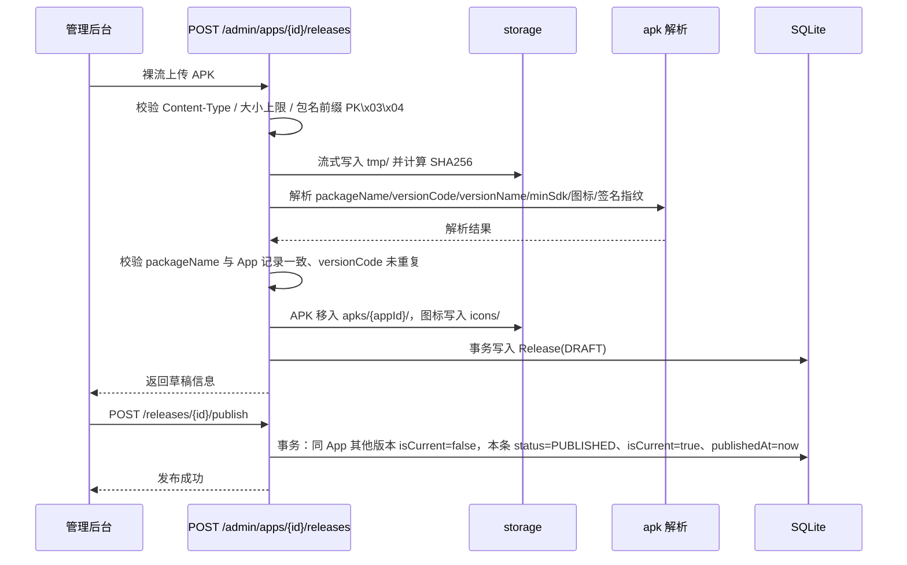
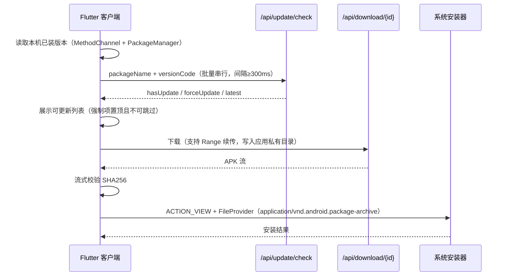
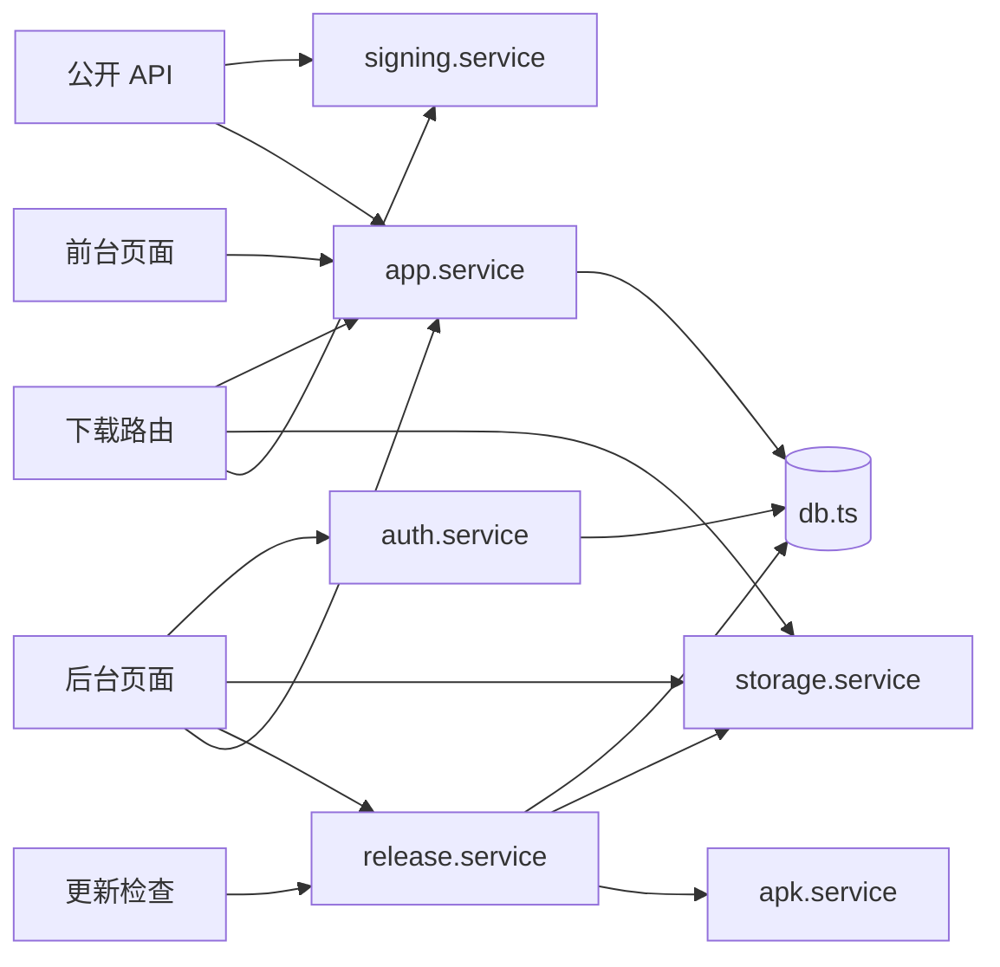

# DESIGN — 个人应用商店（AppStore）

> 阶段：Phase 2 Architect｜依据：CONSENSUS_AppStore.md｜最后更新：2026-11-25
> 环境实测：Node v22.20.0 / npm 11.6.2 / Flutter 3.47.9 / Git 2.53.0

## 1. 总体架构

```mermaid
graph TB
  subgraph clients[客户端层]
    B[浏览器<br/>前台 + 管理后台]
    F[Flutter 商店 App]
    S[自有其他 App<br/>可选接入更新 SDK]
  end

  subgraph web[Next.js 单体应用]
    direction TB
    P[前台页面<br/>App Router + RSC]
    A[管理后台页面]
    R1[/公开 API<br/>/api/public/*/]
    R2[/管理 API<br/>/api/admin/*/]
    R3[/下载路由<br/>/api/download/[id]/]
    R4[/更新检查<br/>/api/update/check/]
    SV[领域服务层<br/>app / release / apk / storage / auth / signing]
  end

  subgraph data[数据与存储]
    DB[(SQLite<br/>Prisma)]
    FS[(本地磁盘 storage/<br/>apks icons screenshots)]
  end

  B --> P
  B --> A
  F --> R1
  F --> R3
  F --> R4
  S --> R4
  P --> R1
  A --> R2
  R1 --> SV
  R2 --> SV
  R3 --> SV
  R4 --> SV
  SV --> DB
  SV --> FS
```

设计要点：
- 单体部署，前后台共用一套数据访问与校验，避免双端逻辑漂移。
- 下载与更新检查独立成路由，便于单独做缓存、限流与签名校验。
- Flutter 客户端只依赖三个公开路由，不接触管理接口。

## 2. 分层设计

| 层 | 职责 | 位置 |
|---|---|---|
| 展示层 | 前台应用墙/详情、后台表单与列表 | `src/app/(public)`、`src/app/admin` |
| 接口层 | 参数解析、鉴权、错误映射，不含业务规则 | `src/app/api/**/route.ts` |
| 领域服务层 | 应用与版本规则、当前版本切换、签名、APK 解析、文件落盘 | `src/server/services/*` |
| 数据访问层 | Prisma Client 单例、事务封装 | `src/server/db.ts` |
| 基础设施 | 存储路径、日志、错误码、常量 | `src/server/infra/*` |

依赖方向严格单向：展示/接口 → 领域服务 → 数据访问/基础设施。领域服务不 import 任何 `next/*`。

## 3. 目录结构

```
c:\Code\AppStore
├─ prisma/
│  ├─ schema.prisma
│  └─ migrations/
├─ src/
│  ├─ app/
│  │  ├─ layout.tsx / globals.css
│  │  ├─ (public)/page.tsx                应用墙
│  │  ├─ (public)/apps/[slug]/page.tsx    详情
│  │  ├─ admin/login/page.tsx
│  │  ├─ admin/apps/page.tsx
│  │  ├─ admin/apps/new/page.tsx
│  │  ├─ admin/apps/[id]/page.tsx
│  │  └─ api/
│  │     ├─ public/apps/route.ts
│  │     ├─ public/apps/[slug]/route.ts
│  │     ├─ public/apps/[slug]/releases/route.ts
│  │     ├─ public/releases/[id]/download-ticket/route.ts
│  │     ├─ download/[id]/route.ts
│  │     ├─ update/check/route.ts
│  │     └─ admin/{login,logout,apps,releases}/...
│  ├─ components/          卡片、筛选栏、标签、表单控件、空态
│  ├─ server/
│  │  ├─ db.ts
│  │  ├─ infra/{env,errors,logger,paths}.ts
│  │  └─ services/{app,release,apk,storage,auth,signing}.ts
│  └─ types/
├─ storage/                apks/ icons/ screenshots/ tmp/
├─ scripts/init-admin.ts
├─ client/                 Flutter 工程
└─ .env.example
```

## 4. 数据模型

SQLite 不支持原生枚举，`type/visibility/status` 用字符串 + 常量约束（`src/server/infra/constants.ts`）。

```prisma
model AdminUser {
  id           String   @id @default(cuid())
  username     String   @unique
  passwordHash String
  createdAt    DateTime @default(now())
}

model App {
  id            String    @id @default(cuid())
  slug          String    @unique
  name          String
  summary       String
  description   String    @default("")
  type          String                       // ANDROID | WEB
  category      String
  tags          String    @default("[]")     // JSON 字符串数组
  iconPath      String?
  screenshots   String    @default("[]")     // JSON 路径数组
  webUrl        String?
  packageName   String?   @unique            // ANDROID 必填
  visibility    String    @default("PUBLIC") // PUBLIC | PRIVATE
  pinned        Boolean   @default(false)
  downloadCount Int       @default(0)
  createdAt     DateTime  @default(now())
  updatedAt     DateTime  @updatedAt
  releases      Release[]

  @@index([type, visibility])
  @@index([category])
}

model Release {
  id                     String    @id @default(cuid())
  appId                  String
  app                    App       @relation(fields: [appId], references: [id], onDelete: Cascade)
  versionName            String
  versionCode            Int
  changelog              String    @default("")
  filePath               String
  fileSize               Int
  sha256                 String
  signFingerprint        String?
  minSdk                 Int?
  forceUpdate            Boolean   @default(false)
  minSupportedVersionCode Int?
  status                 String    @default("DRAFT") // DRAFT | PUBLISHED | ARCHIVED
  isCurrent              Boolean   @default(false)
  downloadCount          Int       @default(0)
  publishedAt            DateTime?
  createdAt              DateTime  @default(now())

  @@unique([appId, versionCode])
  @@index([appId, status, isCurrent])
}
```

不变式（由事务保证）：
1. 同一 `App` 下 `versionCode` 唯一；
2. `isCurrent=true` 的记录在同一 `App` 内至多一条；
3. `isCurrent=true` 隐含 `status=PUBLISHED`；
4. `ANDROID` 类型必须有 `packageName`，`WEB` 类型不产生 `Release`。

## 5. 接口契约

统一约定：成功返回业务 JSON（不加外层包装）；失败返回 `{ "error": { "code": "...", "message": "..." } }` 并带对应 HTTP 状态码。前台页面无缓存（`dynamic = 'force-dynamic'`），列表接口 `Cache-Control: no-store`。

### 5.1 公开接口

**GET `/api/public/apps`**

| 参数 | 说明 |
|---|---|
| `q` | 名称/简介模糊匹配，忽略大小写 |
| `category` | 精确分类 |
| `tag` | 任一标签命中 |
| `type` | `ANDROID` / `WEB` |
| `sort` | `recent`(默认) / `name` / `downloads`，均以 `pinned` 优先 |

```json
{ "total": 12, "items": [{
  "id": "ckx", "slug": "my-notes", "name": "记事本", "summary": "轻量本地笔记",
  "type": "ANDROID", "category": "工具", "tags": ["笔记","离线"],
  "iconUrl": "/api/assets/icons/ckx.png", "packageName": "com.example.notes",
  "pinned": true,
  "downloadCount": 128, "updatedAt": "2026-11-20T08:00:00.000Z",
  "currentVersion": { "versionName": "1.2.0", "versionCode": 12, "publishedAt": "2026-11-20T08:00:00.000Z" }
}]}
```

> `packageName` 供客户端批量更新检测使用，`WEB` 作品为 `null`。

**GET `/api/public/apps/{slug}`** — 返回列表项全部字段 + `description`、`screenshots[]`、`webUrl`、`currentRelease`（含 `changelog`、`fileSize`、`sha256`、`downloadUrl`（10 分钟签名链接）、`forceUpdate`、`minSupportedVersionCode`）、`releases[]`（最近 20 条已发布版本的版本名/版本号/时间）。

**GET `/api/public/apps/{slug}/releases`** — 历史已发布版本分页列表。

**GET `/api/public/releases/{id}/download-ticket`** — 返回 `{ "url": "/api/download/{id}?exp=...&sig=...", "expiresAt": 1764... }`，有效期 600 秒。

**GET `/api/download/{id}?exp=&sig=`**

- `sig = HMAC-SHA256(DOWNLOAD_SIGN_SECRET, "{id}.{exp}")` 小写 hex，`timingSafeEqual` 比对；
- `exp < now` 返回 410 `LINK_EXPIRED`；
- 响应头：`Content-Type: application/vnd.android.package-archive`、`Content-Disposition: attachment; filename*=UTF-8''{name}-{versionName}.apk`、`Accept-Ranges: bytes`、`Content-Length`；
- 支持 `Range`（断点续传），非 200 响应不计数；
- 计数只在 `200` 或 `Range: bytes=0-` 时递增 `App.downloadCount` 与 `Release.downloadCount`。

**GET `/api/update/check?packageName=&versionCode=`**

- 未找到应用或未发布版本：`200 { "hasUpdate": false, "reason": "NOT_FOUND" }`（不返回 4xx，避免客户端反复重试）；
- 比较对象：该 `App` 下 `versionCode` 最大的 `PUBLISHED` 版本（不受 `isCurrent` 影响，回滚不影响更新判定）；
- `forceUpdate = release.forceUpdate || (currentVersionCode < release.minSupportedVersionCode)`；
- 参数非法：400 `VALIDATION_FAILED`。

```json
{
  "hasUpdate": true, "forceUpdate": false, "reason": null,
  "latest": {
    "versionName": "1.3.0", "versionCode": 13, "changelog": "- 修复导入崩溃",
    "fileSize": 18345678, "sha256": "9f2c...", "minSdk": 24,
    "downloadUrl": "/api/download/cky?exp=1764...&sig=...",
    "publishedAt": "2026-11-24T03:00:00.000Z"
  }
}
```

### 5.2 管理接口

鉴权：`POST /api/admin/login` 成功后下发 HS256 JWT（`jose`），存 `HttpOnly; SameSite=Lax; Path=/` Cookie，有效期 7 天；所有 `/api/admin/*` 与 `/admin/*` 页面统一校验。登录失败按 IP 限流（5 次/5 分钟，内存计数）。

| 方法与路径 | 说明 |
|---|---|
| `POST /api/admin/login` | body `{username,password}`，bcrypt 校验（cost 12） |
| `POST /api/admin/logout` | 清除 Cookie |
| `GET /api/admin/apps` | 后台列表（含草稿、私有） |
| `POST /api/admin/apps` | 创建应用（JSON），`type=ANDROID` 必填 `packageName` |
| `PUT /api/admin/apps/{id}` | 更新基本信息、可见性、置顶 |
| `DELETE /api/admin/apps/{id}` | 删除应用与其版本、清理磁盘文件 |
| `POST /api/admin/apps/{id}/releases` | **裸流上传**：`Content-Type: application/octet-stream`，query `filename`，头部 `X-Version-Changelog`（URL 编码），返回解析结果与 Release 草稿 |
| `POST /api/admin/releases/{id}/publish` | 发布并设为当前版本 |
| `POST /api/admin/releases/{id}/set-current` | 回滚到指定历史版本 |
| `POST /api/admin/releases/{id}/archive` | 归档（禁止再被设为当前） |
| `POST /api/admin/apps/{id}/icon` | 上传图标（multipart，≤2MB，png/jpg/webp） |
| `POST /api/admin/apps/{id}/screenshots` | 追加截图（multipart，单张 ≤5MB） |
| `DELETE /api/admin/apps/{id}/screenshots?index=` | 删除指定截图 |

采用裸流而非 multipart 上传 APK：避免 200MB 文件在 Node 进程中整体缓冲。实现用 `Readable.fromWeb(request.body)` + `pipeline` 边落盘边算 SHA256，落盘后再解析 APK；解析出 `versionCode` 后、落盘前先查重，避免覆盖既有版本文件。

补充约定：
- `GET /api/admin/apps` 返回的卡片含 `visibility` 字段，便于后台区分公开/私有；
- `/api/assets/*` 对私有应用的图标与截图要求管理员会话（未登录 401），且响应不缓存；
- 登录/登出通过 `Set-Cookie` 下发与清除，登出仅清 Cookie（JWT 无状态，剩余有效期由 `SESSION_TTL_SECONDS` 控制）。

## 6. 核心数据流

### 6.1 上传并发版



### 6.2 客户端更新与安装



### 6.3 页面渲染

前台页面为动态渲染（`force-dynamic`），直接调用领域服务读取数据库，不经过自身 HTTP 接口，避免自调用开销。管理后台同理，写操作走表单 Server Action 或直接调服务层，公开 API 只服务外部客户端。

## 7. 模块依赖



禁止出现的依赖：`apk.service → release.service`、`signing.service → db.ts`、领域服务 → `next/server`。

## 8. 关键技术实现约定

| 主题 | 约定 |
|---|---|
| APK 解析 | `app-info-parser` 提取 `package/versionCode/versionName/minSdkVersion/application.icon`；图标 buffer 转 PNG 落盘；解析失败即删除临时文件并返回 `APK_PARSE_FAILED` |
| 签名指纹 | 解析 `META-INF/*.RSA` 证书 SHA-256，解析不到时置空并在后台提示 |
| 流式上传 | `pipeline(Readable.fromWeb(body), sha256Transform, fs.createWriteStream(tmp))`，上限 200MB，超限中断并清理 |
| 文件命名 | 磁盘文件名只用 `cuid` 与 `versionCode`，不采用用户输入，杜绝路径穿越 |
| 下载 | `fs.createReadStream(path, {start, end})`，手动拼 `206 Partial Content` 与 `Content-Range` |
| 会话 | `jose` HS256，密钥 `SESSION_SECRET`，Cookie 不存用户敏感信息 |
| 输入校验 | `zod` 校验所有写接口 body 与 query；slug 仅允许 `[a-z0-9-]{2,48}` |
| 图片处理 | 图标统一转 512×512 PNG，截图保留原图并限制单张 5MB |
| 样式 | Tailwind，自定义设计令牌；支持深浅色；卡片栅格随内容自适应 |
| 打包 | `npm run build` + `next start -H 0.0.0.0 -p 3000`；Windows 本机用 `npm run dev` 调试 |

## 9. 异常处理策略

### 9.1 错误码

| code | HTTP | 场景 | 前端/客户端表现 |
|---|---|---|---|
| `VALIDATION_FAILED` | 400 | 参数缺失或格式错误 | 表单行内提示具体字段 |
| `UNAUTHORIZED` | 401 | 未登录 / 会话过期 | 跳转登录页 |
| `FORBIDDEN` | 403 | 签名不匹配 / 无权访问私有应用 | 提示链接失效 |
| `NOT_FOUND` | 404 | 应用、版本或文件不存在 | 空态页 |
| `LINK_EXPIRED` | 410 | 下载链接过期 | 前台自动重新取 ticket 重试一次 |
| `FILE_TOO_LARGE` | 413 | 超过 200MB | 上传前即阻断并提示上限 |
| `UNSUPPORTED_TYPE` | 415 | 非 APK / 非图片 | 提示允许的格式 |
| `PACKAGE_MISMATCH` | 422 | APK 包名与应用记录不一致 | 显示两个包名，拒绝入库 |
| `VERSION_CONFLICT` | 409 | 同版本号重复 | 提示已存在并可查看该版本 |
| `APK_PARSE_FAILED` | 422 | 解析失败 | 显示失败原因，保留已上传临时文件供排查（手动清理） |
| `RATE_LIMITED` | 429 | 登录失败次数超限 | 提示 5 分钟后再试 |
| `INTERNAL_ERROR` | 500 | 未预期异常 | 通用提示 + 服务端记录 requestId |

### 9.2 分端兜底

- **服务端**：路由统一 `try/catch` → `toErrorResponse(err)`；所有写操作使用 Prisma 事务；上传流程任一步失败都清理 `tmp/` 文件；日志记录 `requestId`、路径、耗时，不含密码与签名密钥。
- **Web 前台**：详情与列表使用 `error.tsx` / `not-found.tsx`；下载失败展示原因并提供「重新获取链接」按钮。
- **Flutter 客户端**：网络错误指数退避重试（3 次，1s/2s/4s）；下载中断保留 `.part` 文件支持续传；SHA256 不匹配删除文件并提示重试；安装被拒时引导到「安装未知应用」设置页。

## 10. 部署与环境变量

```dotenv
BASE_URL=http://192.168.1.10:3000
DATABASE_URL="file:./data/appstore.db"
STORAGE_DIR=./storage
DOWNLOAD_SIGN_SECRET=<32 字节随机串>
SESSION_SECRET=<32 字节随机串>
ADMIN_USERNAME=admin
ADMIN_PASSWORD=<首次初始化明文，仅用于 scripts/init-admin.ts>
MAX_APK_MB=200
NEXT_PUBLIC_SITE_NAME=我的应用仓库
```

- 内网试用期允许明文 HTTP；Flutter 客户端 `network_security_config` 仅对内网 IP 开明文，上线切 HTTPS 后移除。
- 管理员首次创建：`npm run init-admin`，读取 `ADMIN_PASSWORD` 生成 bcrypt 哈希入库，之后从 `.env` 删除该字段。

## 11. 设计自检

| 检查项 | 结论 |
|---|---|
| 与 CONSENSUS 12 条验收标准对应 | 全覆盖（F1–F12 均有落点） |
| 是否引入超范围能力 | 无（无多用户、灰度、静默安装、对象存储） |
| 接口是否需要客户端额外适配 | 否，客户端仅依赖 3 个公开路由 |
| 大文件路径是否有内存风险 | 已规避，裸流落盘 + 边写边算哈希 |
| 回滚与更新判定是否冲突 | 已解耦：更新取最大 versionCode，展示取 isCurrent |
