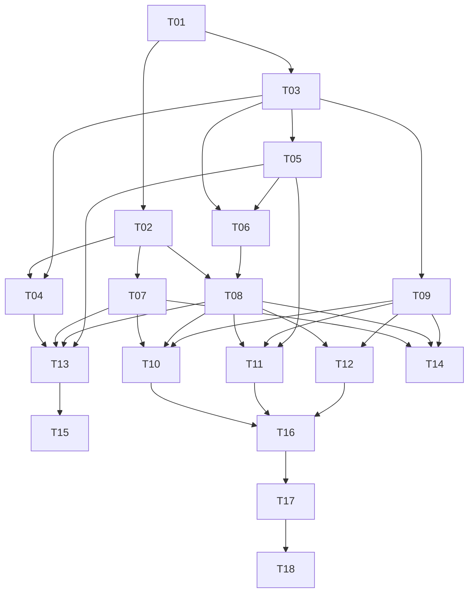

# TASK — 个人应用商店（AppStore）

> 阶段：Phase 3 Atomize｜依据：DESIGN_AppStore.md｜最后更新：2026-11-25
> 说明：任务按依赖顺序编号，每个任务独立可验证。批次（B1–B6）用于分步交付，每批完成后暂停确认。

## 1. 任务总览

| 编号 | 任务 | 批次 | 依赖 |
|---|---|---|---|
| T01 | 工程骨架与工具链 | B1 | — |
| T02 | 数据模型与初始化 | B1 | T01 |
| T03 | 基础设施层（env/错误码/日志/路径） | B1 | T01 |
| T04 | 鉴权服务 | B1 | T02,T03 |
| T05 | 存储服务 | B1 | T03 |
| T06 | APK 解析服务 | B1 | T03,T05 |
| T07 | 应用服务 | B2 | T02,T03 |
| T08 | 版本服务 | B2 | T02,T06 |
| T09 | 签名服务 | B2 | T03 |
| T10 | 公开 API | B2 | T07,T08,T09 |
| T11 | 下载路由（Range + 计数） | B2 | T08,T09,T05 |
| T12 | 更新检查接口 | B2 | T08,T09 |
| T13 | 管理 API | B3 | T04,T07,T08,T05 |
| T14 | Web 前台界面 | B4 | T07,T08,T09 |
| T15 | 管理后台界面 | B4 | T13 |
| T16 | Flutter 客户端 | B5 | T10,T11,T12 |
| T17 | 更新接入示例与部署文档 | B6 | T12,T16 |
| T18 | 端到端验收 | B6 | 全部 |

## 2. 依赖关系

## 3. 批次划分

| 批次 | 内容 | 完成标志 |
|---|---|---|
| B1 | T01–T06 | `npm run typecheck` 通过，APK 解析脚本可对样例包输出正确包名与版本 |
| B2 | T07–T12 | curl 可列出应用、取签名链接下载、更新接口返回正确 JSON |
| B3 | T13 | 后台可完成「登录 → 建应用 → 上传 APK → 发布」全链路 |
| B4 | T14–T15 | 前台可浏览下载，后台页面完整可用 |
| B5 | T16 | Flutter APK 可安装，能浏览、下载、检测更新、自更新 |
| B6 | T17–T18 | 验收清单全绿，部署文档可照做 |

## 4. 任务详述

### T01 工程骨架与工具链

- **输入**：空工作区；Node 22.20.0、npm 11.6.2 已就绪。
- **动作**：`create-next-app`（TypeScript + App Router + Tailwind + ESLint，`src/` 目录，导入别名 `@/*`）；安装 `prisma @prisma/client bcryptjs jose zod app-info-parser sharp`；配置 `npm run` 脚本（`dev/build/start/typecheck/lint/db:migrate/db:studio/init-admin`）；创建 `.env.example` 与 `storage/{apks,icons,screenshots,tmp}`；`.gitignore` 排除 `.env`、`storage/`、`data/`。
- **输出**：可 `npm run dev` 启动的空壳站点；目录结构与 DESIGN 第 3 节一致。
- **约束**：不引入 UI 组件库；不引入状态管理库；不使用 `pages/` 目录。
- **验收**：`npm run build` 通过；`npm run typecheck` 0 error；首页返回 200；`.env` 未被跟踪。
- **测试**：无（骨架），以构建与启动为验证。

### T02 数据模型与初始化

- **输入**：T01 完成、`DATABASE_URL` 可配置。
- **动作**：按 DESIGN 第 4 节编写 `prisma/schema.prisma`；生成首个 migration；实现 `src/server/db.ts` 单例；`scripts/init-admin.ts` 读取 `ADMIN_USERNAME/ADMIN_PASSWORD` 写入 bcrypt 哈希（幂等：已存在则更新密码）；`src/server/infra/constants.ts` 定义 `AppType/Visibility/ReleaseStatus` 常量与联合类型。
- **输出**：`data/appstore.db` 可创建；`npm run init-admin` 成功写入管理员。
- **约束**：SQLite 不建枚举；`tags/screenshots` 以 JSON 字符串存储并统一在服务层解析。
- **验收**：`npx prisma migrate dev` 成功；`prisma studio` 可见两张表；重复执行 `init-admin` 不产生重复用户。
- **测试**：`init-admin` 重复执行幂等性手测。

### T03 基础设施层

- **输入**：T01。
- **动作**：`infra/env.ts` 用 zod 校验并导出强类型环境变量（缺 `DOWNLOAD_SIGN_SECRET` 等启动即失败）；`infra/errors.ts` 定义 `AppError` 与 DESIGN 9.1 全部错误码 + `toErrorResponse()`；`infra/logger.ts` 输出带 `requestId` 的结构化日志且脱敏；`infra/paths.ts` 统一存储路径解析与目录自建。
- **输出**：四个模块 + 单元测试。
- **约束**：不依赖 `next/*`；日志不输出密码、Cookie、签名密钥。
- **验收**：单测覆盖错误码映射与 env 缺失时的抛错；`tsc` 通过。
- **测试**：Vitest（或 Node test runner）单测，≥6 个用例。

### T04 鉴权服务

- **输入**：T02、T03。
- **动作**：`services/auth.service.ts`：`verifyCredentials`、`createSessionToken`、`verifySessionToken`、`getSession`（读 Cookie）、`requireAdmin`（供路由与页面调用）；IP 限流（内存 Map，5 次/5 分钟，含清理）；`middleware.ts` 或布局层保护 `/admin/*`。
- **输出**：登录、登出、会话校验能力。
- **约束**：jose HS256；Cookie `HttpOnly; SameSite=Lax; Path=/; Max-Age=604800`；不实现刷新令牌。
- **验收**：正确密码拿到 Cookie；错误密码 5 次后被 429；篡改 token 校验失败；过期 token 失败。
- **测试**：单测覆盖 token 签发/校验/篡改/过期 + 限流边界。

### T05 存储服务

- **输入**：T03。
- **动作**：`storage.service.ts`：`ensureDirs`、`saveIcon(buffer, appId)`（sharp 转 512×512 PNG）、`saveScreenshot`、`moveApkToFinal(tmpPath, appId, versionCode)`、`removeAppFiles(appId)`、`removeFile(path)`、`createTempFile()`；所有路径由内部生成，不接受外部文件名。
- **输出**：文件读写与清理能力。
- **约束**：磁盘命名只用 `cuid`/`versionCode`；删除操作必须限定在 `STORAGE_DIR` 内（防路径穿越）。
- **验收**：上传 png/jpg 图标均输出 512×512 PNG；非法路径抛错；`removeAppFiles` 后目录为空。
- **测试**：单测 + 临时目录手测。

### T06 APK 解析服务

- **输入**：T03、T05；一份真实 APK 样例。
- **动作**：`apk.service.ts`：`streamToTemp(readable)` 边写边算 SHA256 与字节数、超 200MB 中断清理；`parseApk(tmpPath)` 用 `app-info-parser` 取 `packageName/versionCode/versionName/minSdkVersion/icon`；`extractSignFingerprint` 读 `META-INF/*` 证书 SHA-256；`assertZipMagic` 校验文件头。
- **输出**：`{ packageName, versionCode, versionName, minSdk, sha256, fileSize, iconBuffer, signFingerprint }`。
- **约束**：解析失败必须清理临时文件；`versionCode` 统一转 number；图标缺失时返回 null 不阻断发布。
- **风险**：`app-info-parser` 在 Node 22 的兼容性。若不兼容，改用 `@devicefarmer/adbkit-apkreader`，接口保持不变，仅替换实现。
- **验收**：对样例 APK 输出的包名、版本号与 Android Studio 显示一致；SHA256 与 `certutil -hashfile` 一致；损坏文件返回 `APK_PARSE_FAILED` 且 tmp 目录无残留。
- **测试**：单测（正常包、截断包、非 zip 包三种）。

### T07 应用服务

- **输入**：T02、T03。
- **动作**：`app.service.ts`：`listPublicApps(filters)`（关键词、分类、标签、类型、排序、`pinned` 优先、仅 PUBLIC）、`listAdminApps`、`getAppBySlug`、`getAppById`、`createApp`、`updateApp`、`deleteApp`（级联清理磁盘）、`assertSlugAvailable`；`ANDROID` 必须有 `packageName`、`WEB` 必须有 `webUrl`。
- **输出**：应用域 CRUD 与查询。
- **约束**：`tags/screenshots` 在返回时反序列化为数组；`pinned` 排序优先级最高。
- **验收**：筛选组合结果正确；创建重复 slug 返回 `VALIDATION_FAILED`；删除应用后其 release 与文件均消失。
- **测试**：针对 SQLite 临时库的服务层单测 ≥8 例。

### T08 版本服务

- **输入**：T02、T06。
- **动作**：`release.service.ts`：`createDraft`（校验包名一致、versionCode 唯一）、`publish`、`setCurrent`、`archive`、`getLatestByVersionCode`、`evaluateUpdate(packageName, currentVersionCode)`、`listPublishedReleases`；全部写操作走 Prisma 事务，维护「同 App 仅一条 isCurrent」。
- **输出**：版本生命周期与更新判定。
- **约束**：`setCurrent` 只允许 `PUBLISHED` 记录；`archive` 不影响历史下载链接可用性。
- **验收**：发布新版后旧版 `isCurrent=false`；回滚后 `evaluateUpdate` 仍返回最大版本号；重复 versionCode 返回 `VERSION_CONFLICT`；`forceUpdate` 与 `minSupportedVersionCode` 组合判断正确。
- **测试**：单测覆盖发布/回滚/并发两次发布（事务互斥）/强制更新判定，≥10 例。

### T09 签名服务

- **输入**：T03（`DOWNLOAD_SIGN_SECRET`）。
- **动作**：`signing.service.ts`：`signDownloadUrl(releaseId, ttl=600)`、`verifyDownloadSig(releaseId, exp, sig)`（`timingSafeEqual`）、`buildAbsoluteUrl(path)`（基于 `BASE_URL`）。
- **输出**：签名 URL 与校验函数。
- **约束**：hex 小写；时间用 Unix 秒；同一 release 同一时刻可生成不同 `exp` 的链接。
- **验收**：正常签名校验通过；改动 `exp` 或 `sig` 任一位失败；过期返回 `LINK_EXPIRED`。
- **测试**：单测 ≥6 例。

### T10 公开 API

- **输入**：T07、T08、T09。
- **动作**：实现 DESIGN 5.1 的 `apps` 列表、`apps/{slug}` 详情、`apps/{slug}/releases` 历史、`releases/{id}/download-ticket` 四个 Route Handler；用 zod 校验 query；统一 `toErrorResponse`；`Cache-Control: no-store`。
- **输出**：4 个可用接口。
- **约束**：仅返回 `PUBLIC` 应用；详情内 `downloadUrl` 为 600 秒签名链接；不得暴露 `filePath`、`sha256` 以外的内部字段（`sha256` 对外可用，`filePath` 不可）。
- **验收**：curl 各接口返回符合契约；私有应用返回 404；非法参数返回 400；响应不含磁盘路径。
- **测试**：脚本化 curl 断言（`scripts/api-smoke.ps1`）。

### T11 下载路由

- **输入**：T05、T08、T09。
- **动作**：`/api/download/[id]` 实现签名校验、过期判定、`Range` 解析与 `206`、正确响应头、计数递增（仅 `200` 或 `bytes=0-`）。
- **输出**：可断点续传的下载端点。
- **约束**：不整体读入内存；文件缺失返回 404 并记录日志；不使用 `sendFile` 之类会吞 Range 的封装。
- **验收**：`curl -I` 返回 `Accept-Ranges: bytes`；`curl -r 0-1023` 返回 206 且长度 1024；完整下载 SHA256 与库一致；续传不重复计数；过期链接 410。
- **测试**：`scripts/api-smoke.mjs` 覆盖上述 5 项。

### T12 更新检查接口

- **输入**：T08、T09。
- **动作**：`/api/update/check` 实现参数校验、未找到返回 `200 hasUpdate:false`、最新版本比对、强制更新计算、返回带签名 `downloadUrl`。
- **输出**：单一更新检查端点。
- **约束**：不因应用不存在返回 4xx；`publishedAt` 用 ISO 8601。
- **验收**：当前版本=最新时 `hasUpdate=false`；低版本时返回完整 `latest`；低于 `minSupportedVersionCode` 时 `forceUpdate=true`；不存在的包名返回 200 与 `reason=NOT_FOUND`。
- **测试**：单测 + curl 断言。

### T13 管理 API

- **输入**：T04、T05、T07、T08。
- **动作**：实现 DESIGN 5.2 全部路由：登录/登出、应用 CRUD、裸流上传 APK（`Readable.fromWeb` + `pipeline` + 哈希）、发布/设当前/归档、图标与截图上传/删除；所有路由先 `requireAdmin`。
- **输出**：完整管理接口。
- **约束**：上传必须流式，不得 `arrayBuffer()`；任一步失败清理临时文件与已落盘文件；登录限流生效。
- **验收**：未登录全部 401；上传后返回解析结果与草稿；发布后公开接口立即可见；`PACKAGE_MISMATCH`、`VERSION_CONFLICT`、`FILE_TOO_LARGE` 均正确返回。
- **测试**：`scripts/admin-smoke.mjs` 走完整链路。

### T14 Web 前台界面

- **输入**：T07、T08、T09。
- **动作**：应用墙（卡片栅格随数量自适应、置顶标记、类型徽标）、搜索框（防抖）、分类与标签筛选、排序切换、详情页（截图预览、版本信息、更新日志、下载按钮）、空态与错误态、深浅色跟随系统、移动端适配。
- **输出**：可浏览可下载的前台。
- **约束**：不引入 UI 库；卡片不得固定列数导致空白；所有按钮文字单行；下载按钮点击时实时取 ticket；不使用花哨动效。
- **验收**：搜索/筛选/排序组合正确；下载按钮真实产出文件；1440 与 390 视口无横向滚动；空结果有空态；深浅色无对比度问题。
- **测试**：浏览器手测清单（含窄屏）。

### T15 管理后台界面

- **输入**：T13。
- **动作**：登录页、应用列表（含草稿/私有标识、图标按钮操作）、新建/编辑表单（字段全部平铺可见、分组清晰）、APK 上传（进度条、解析结果回显、失败原因）、版本列表（发布/设为当前/归档）、截图管理。
- **输出**：完整后台。
- **约束**：表单说明文字用问号图标 + 悬浮提示；危险操作二次确认；上传失败必须显示具体错误码文案。
- **验收**：完成「登录 → 建应用 → 上传 APK → 发布 → 前台可见」全流程；错误场景有明确提示；刷新后状态保持。
- **测试**：后台手测清单。

### T16 Flutter 客户端

- **输入**：T10、T11、T12。
- **动作**：`client/` 工程（Android only）；`core/config`（基地址可配）、`core/api_client`（dio，统一错误映射、超时、重试）、模型与仓库层；首页应用墙、详情、下载（进度、续传、SHA256 校验）、安装（FileProvider + ACTION_VIEW）；更新页（已装版本比对、单条/全部更新、强制更新不可跳过）；自更新；Kotlin MethodChannel 读取已安装包版本；权限声明与「安装未知应用」引导。
- **输出**：可安装的商店 APK。
- **约束**：权限仅 `INTERNET`、`REQUEST_INSTALL_PACKAGES`、`QUERY_ALL_PACKAGES`；下载落在应用私有目录；明文 HTTP 仅对配置的内网地址放开；不申请存储写权限（分区存储）。
- **验收**：真机可浏览、下载、调起安装器并安装成功；改库里的版本号后客户端能检出并更新；下载中断后重进可续传；SHA256 不符时给出错误且不留残包；1.3x 字体与窄屏不溢出。
- **测试**：真机手测清单（两檔屏宽）。

### T17 更新接入示例与部署文档

- **输入**：T12、T16。
- **动作**：编写最小接入示例（Android/Kotlin 与 Flutter 各一段，仅调用更新接口 + 下载 + 安装的思路与代码片段）；编写 `docs/AppStore/DEPLOY_AppStore.md`（初始化、`.env` 说明、首次建管理员、内网访问、备份 `data/` 与 `storage/`、切换 HTTPS 步骤）；补充 `scripts/` 冒烟脚本说明。
- **输出**：接入示例与部署文档。
- **约束**：示例代码不含密钥；文档步骤必须实际可执行。
- **验收**：按文档在干净目录可完成启动与首次发版。
- **测试**：文档走查 + 实际执行一遍。

### T18 端到端验收

- **输入**：全部任务完成。
- **动作**：生成 `ACCEPTANCE_AppStore.md`，逐条对照 CONSENSUS F1–F12 记录实测结果与证据（命令输出、截图路径）；跑 `npm run build`、`npm run typecheck`、`npm run lint`、单测、`flutter analyze`、`flutter build apk`。
- **输出**：验收记录。
- **约束**：未实测项必须显式标注，不得以「应该可以」代替。
- **验收**：F1–F12 全部有可复现证据或明确标注为待补测。
- **测试**：本身即验收。

## 5. 质量门（每批次结束必查）

1. `npm run typecheck` 0 error、`npm run lint` 0 error。
2. `npm run build` 成功（B1 之后每批）。
3. 本批次新增逻辑有对应单测或冒烟脚本。
4. README 进度表已更新，未完成项记入 TODO 文档。
5. 不修改 DESIGN 定义的接口契约；若必须修改，先更新 DESIGN 再改代码。
